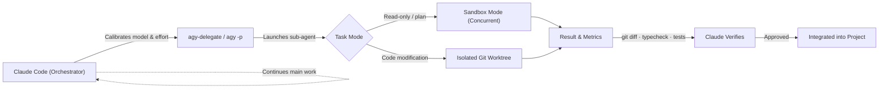

<div align="center">

# Claude Code Antigravity Agents

*Turn Claude Code into an orchestrator: delegate heavy jobs to Google Antigravity sub-agents with fine-grained control and automated quota protection.*

[](https://claude.com/claude-code)
[](https://antigravity.google/docs/cli/getting-started)
[](#how-it-works)
[](#install-the-skill)
[](#prerequisites)
[](#license)

**Enhanced Fork by [Kuzey Tarhun](https://github.com/ktarxhun)**  
*Originally created by [Mark Fulton](https://www.reinventing.ai/)*

</div>

---

A modular Claude Code **skill** (`antigravity-agents`) and runner utility (`bin/agy-delegate`) that empowers [Claude Code](https://claude.com/claude-code) to orchestrate the [Google Antigravity CLI](https://antigravity.google/docs/cli/getting-started) (`agy`).

With this skill loaded, Claude Code ceases to be a solo worker burning expensive frontier tokens on repetitive boilerplate. It becomes a **conductor**: deciding architectural strategy, picking the right model tier, tuning reasoning effort, dispatching sub-agent tasks, and verifying every line of generated code before merging.

## What Makes This Fork Different?

This fork adds full control over the Antigravity engine rather than treating it as a black box:

- **Proactive-First Triggering:** Claude automatically delegates routine frontend, Tailwind, and boilerplate work without waiting for explicit prompt instructions.
- **Automated Quota Guard & Fallback:** `agy-delegate` detects rate limits (429, resource exhausted) and signals code 42. For quick tasks, Claude automatically falls back to internal thinking; for large tasks, it asks the user for guidance.
- **Reasoning Effort Calibration (`--effort`):** Dynamically calibrate thinking effort (`low`, `medium`, `high`, `xhigh`, `max`). Use `low` for zero-latency HTML/CSS and boilerplate; reserve `max` for deep security audits and complex algorithms.
- **Modern Model Matrix:** Updated for modern model slugs (`gemini-3.8-flash-high`, `gemini-4-argon-high`, etc.).
- **Deterministic Session Memory (`--conversation <id>`):** Track and resume specific multi-turn conversations for feedback loops without race conditions.
- **Execution Modes (`--mode plan | accept-edits`):** Explicitly command sub-agents to formulate read-only architectural plans or apply direct file modifications.
- **Bundled Runner (`bin/agy-delegate`):** A zero-dependency Python helper that prevents non-interactive stdin deadlocks (`</dev/null`), manages timeouts, and formats structured outputs.

## Contents

- [Why You Want This](#why-you-want-this)
- [How It Works](#how-it-works)
- [The Orchestration Control Panel](#the-orchestration-control-panel)
- [Quota Guard & Fallback Protocol](#quota-guard--fallback-protocol)
- [Prerequisites](#prerequisites)
- [Install the Skill](#install-the-skill)
- [Usage Examples](#usage-examples)
- [Safety Model](#safety-model)
- [License & Attribution](#license--attribution)

## Why You Want This

- **Save Your High-Tier Tokens:** Large repo audits, extensive refactors, and boilerplate frontend tasks consume excessive context. Offload the heavy lifting to Antigravity workers while Claude keeps its context clean.
- **Right Model for the Right Job:** Pair Claude's unmatched architectural reasoning with Gemini 3.8 Flash's extreme throughput and Google AI quotas.
- **Independent Second Opinions:** Get a genuinely distinct model to audit pull requests or review critical architecture without bias.
- **True Concurrency:** Fan out 2 to 4 parallel sub-agent jobs at once while Claude Code stays responsive.

| Capability | Solo Claude Code Session | With `antigravity-agents` |
| :--- | :--- | :--- |
| Long audits / boilerplate | Burns primary context and rate limits | Handed off to isolated Antigravity worker |
| Reasoning depth | Fixed single-model behavior | Configurable per-task thinking effort (`low` to `max`) |
| Quota exhaustion | Stalls or errors out | Automatic fallback to internal thinking or user prompt |
| Second opinion | Same model reviewing itself | Genuinely independent multi-model verification |
| Throughput | Serial execution | Concurrent background workers |
| Token expenditure | Spent on mechanical typing | Preserved for high-level orchestration |

## How It Works



## The Orchestration Control Panel

Claude calibrates every delegated task using these operational dimensions:

### 1. Reasoning Effort (`--effort`)

- `low`: Mechanical tasks, static HTML/CSS, Tailwind styling, boilerplate, lint fixes. Zero hesitation, instant code output.
- `medium`: Standard component logic, isolated utilities, unit test suites. Balanced speed and reasoning.
- `high`: Cross-module integration, API clients, data transformation pipelines.
- `max`: Architectural security audits, protocol implementations, deep debugging.

### 2. Model Selection (`--model`)

- `gemini-3.8-flash-high` / `gemini-3.8-flash-medium`: Recommended default for frontend and routine implementation.
- `gemini-4-argon-high` / `gemini-4-argon-medium`: Advanced reasoning and complex codebase reviews.
- `claude-opus-5-5-high`: High-end cross-model verification.

### 3. Session Resumption (`--conversation`)

Pass the conversation ID returned from previous jobs to send revision requests ("fix the type error on line 42") without re-explaining the entire project context from scratch.

## Quota Guard & Fallback Protocol

If Antigravity hits rate limits or temporary account capacity exhaustion:
1. `agy-delegate` catches the error and exits with code `42`.
2. **For quick/medium tasks (under 150 lines):** Claude automatically solves the task inside its own context without interrupting you.
3. **For large/multi-file tasks:** Claude stops and asks whether you prefer waiting or running the full job in Claude's context.

## Prerequisites

Two quick one-time setup steps:

**1. Install the Antigravity CLI (`agy`)**

On macOS / Linux:
```bash
curl -fsSL https://antigravity.google/cli/install.sh | bash
```

On Windows (PowerShell):
```powershell
irm https://antigravity.google/cli/install.ps1 | iex
```

**2. Complete Google Authentication**

Run `agy` once in your terminal to complete the Google OAuth sign-in in your browser:
```bash
agy
```

## Install the Skill

Clone this repository and copy the `antigravity-agents` directory to your Claude skills location:

**Linux / macOS**
```bash
git clone https://github.com/ktarxhun/claude-antigravity-agents.git
mkdir -p ~/.claude/skills
cp -r claude-antigravity-agents/antigravity-agents ~/.claude/skills/
```

**Windows (PowerShell)**
```powershell
git clone https://github.com/ktarxhun/claude-antigravity-agents.git
New-Item -ItemType Directory -Force -Path "$env:USERPROFILE\.claude\skills"
Copy-Item -Recurse claude-antigravity-agents\antigravity-agents "$env:USERPROFILE\.claude\skills\"
```

Claude Code auto-discovers the skill on the next session.

## Usage Examples

You can delegate directly in natural language:

> *"Have Antigravity build the frontend Navbar component using Tailwind on low effort while you design the backend API."*

> *"Spin up an Antigravity sub-agent using gemini-4-argon-high on max effort to audit src/auth/ for session fixation vulnerabilities."*

> *"Ask Antigravity for a second opinion on this database schema in plan mode, and keep working on the checkout service."*

Or run tasks manually using the bundled runner:
```bash
agy-delegate \
  --model gemini-3.8-flash-high \
  --effort low \
  --mode plan \
  "Build a responsive product pricing card with Tailwind CSS. Output clean TSX."
```

## Safety Model

Delegation only succeeds if the workspace remains deterministic:

1. **Isolation Rule:** Sub-agents never write to the same files Claude Code is actively modifying. Read-only jobs run in sandbox mode; write jobs run in isolated git worktrees or dedicated sub-directories.
2. **Verification Protocol:** Claude inspects the `git diff` and runs the project's build and test suites (`npm test`, `cargo check`, etc.) on all returned work before merging.
3. **Protected Actions:** Production deployments, database migrations, and destructive file deletions are never delegated to sub-agents.

## License & Attribution

- Enhanced and maintained by **[Kuzey Tarhun](https://github.com/ktarxhun)**
- Original project created by **[Mark Fulton](https://markfulton.com)**
- Released under the [MIT License](LICENSE).
